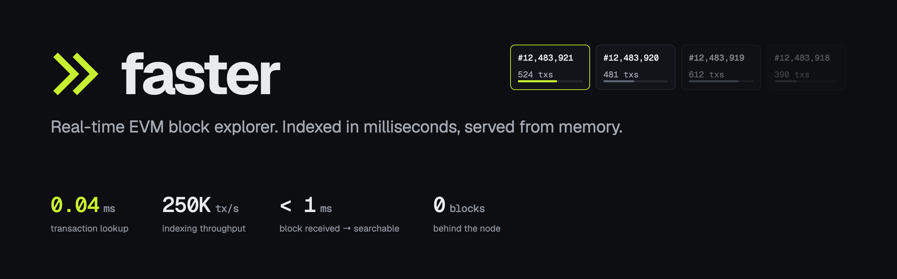
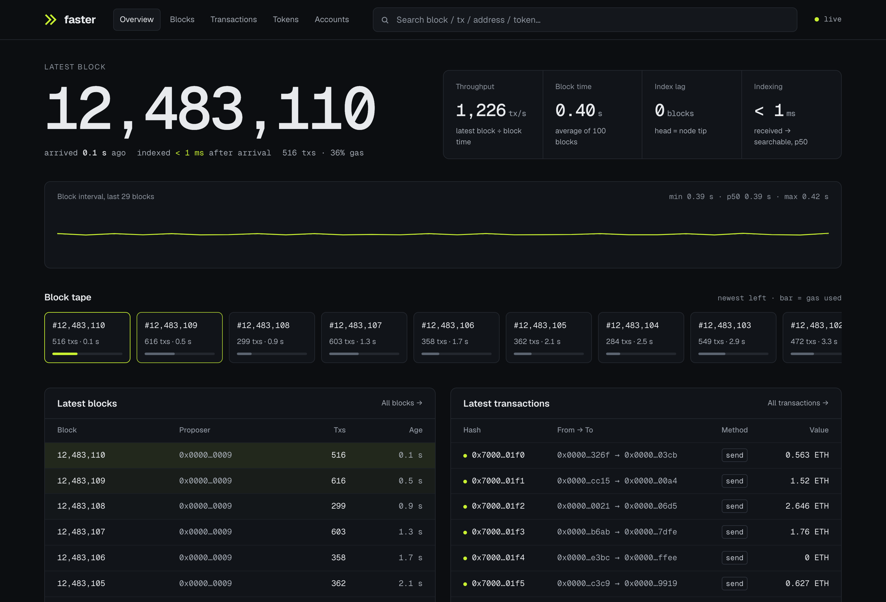
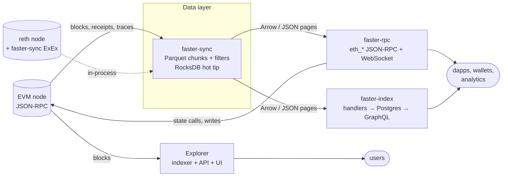

<p align="center">
  
</p>

<h1 align="center">Faster</h1>

<p align="center">
  <strong>A real-time block explorer and chain data stack for EVM networks.</strong><br>
  Index any chain, browse it live, query its full history in milliseconds, and serve it over standard JSON-RPC and GraphQL.
</p>

<p align="center">
  <a href="https://github.com/abhijitkrm/faster/releases/latest"></a>
  <a href="https://github.com/abhijitkrm/faster/actions/workflows/release.yml"></a>
  <a href="#license"></a>
</p>

<p align="center">
  <a href="#quick-start">Quick start</a> ·
  <a href="#components">Components</a> ·
  <a href="#architecture">Architecture</a> ·
  <a href="#performance">Performance</a> ·
  <a href="#documentation">Docs</a> ·
  <a href="CONTRIBUTING.md">Contributing</a>
</p>

---

Faster is an open-source stack for working with EVM chain data. It runs next
to any node that speaks Ethereum JSON-RPC and gives you:

- **A live block explorer** that shows blocks, transactions, tokens and
  contracts as they are produced, served from an embedded store with no
  database hop.
- **A history API** that returns the blocks, transactions, receipts, logs and
  traces matching a filter across any block range, in milliseconds, as JSON or
  Apache Arrow.
- **A JSON-RPC server** that answers the standard read methods from that index,
  so `eth_getLogs` over millions of blocks is cheap and your node is left to
  execution.
- **An indexing framework** that turns contract events into your own entities
  with a GraphQL API, and handles reorgs for you.

Use the whole stack, or only the parts you need. Everything starts with one
command.

<p align="center">
  
</p>

## Quick start

You need Docker with Compose v2. Nothing else: the demo profile brings its own
synthetic chain.

```sh
git clone https://github.com/abhijitkrm/faster.git
cd faster
./fasterctl up demo
```

When the images are built and the stack is running:

| Open | What you get |
|---|---|
| http://localhost:4000 | Block explorer |
| http://localhost:8545 | Ethereum JSON-RPC (faster-rpc) |
| http://localhost:3100 | History API (faster-sync), see [API reference](faster-sync/docs/API.md) |
| http://localhost:8080/graphql | GraphQL for the example indexer (faster-index) |

`./fasterctl status` shows which services are answering, `./fasterctl logs <service>`
follows one, and `./fasterctl down` stops everything.

### Run against your own chain

```sh
cp .env.example .env
# set RPC_URL to your node, e.g. RPC_URL=http://my-node:8545
./fasterctl up all
```

Pick only what you need with profiles:

| Profile | Starts | Use it for |
|---|---|---|
| `explorer` | explorer indexer + API, web UI | A block explorer for your chain |
| `data` | faster-sync, faster-rpc | Fast history queries and a read-scalable RPC endpoint |
| `index` | faster-sync, faster-index, Postgres | Building an app backend on your contracts' events |
| `all` | all of the above | The full stack |
| `demo` | a synthetic chain | Trying Faster without a node |
| `clob` | ClickHouse, CLOB archiver | Order-book history for CLOB chains (optional) |

```sh
./fasterctl up explorer        # only the explorer
./fasterctl up data index      # history API, JSON-RPC and an indexer
```

Every setting (node URL, ports, start blocks, rate limits for public endpoints,
API keys, which indexer project to run) is documented in
[`.env.example`](.env.example). Plain `docker compose --profile <name> up -d`
works too.

## Components

| | Component | Language | What it does |
|---|---|---|---|
| 🔎 | [**Explorer**](faster-explorer) | Rust, TypeScript | Indexer, REST API and WebSocket feed in a single process over an embedded RocksDB store, with a React UI. Verified contracts, decoded calls and events, tokens and holders, internal transactions, reorg handling. |
| ⚡ | [**faster-sync**](faster-sync) | Rust | Historical data API. Finalized history lives in immutable Parquet chunks with per-chunk filters; the unfinalized tip lives in RocksDB and rolls back on reorgs. Ingests over JSON-RPC, or in-process from reth through an [execution extension](faster-sync/reth). Clients for [Rust](faster-sync/clients/rust) and [TypeScript](faster-sync/clients/ts). |
| 🔌 | [**faster-rpc**](faster-rpc) | Rust | Ethereum JSON-RPC served from faster-sync: blocks, transactions, receipts, `eth_getLogs` over any range, and WebSocket `newHeads`/`logs` subscriptions with reorg notifications. State calls and writes are forwarded to your node. |
| 🧩 | [**faster-index**](faster-index) | TypeScript | Indexing framework: declare contracts and events in YAML, write handlers in TypeScript, get Postgres entities and a GraphQL API. Backfills from faster-sync, follows the head and rolls back on reorgs. |

Each component is a self-contained project with its own README, tests and
Dockerfile, and can be deployed on its own.

## Architecture



- **Ingest once, serve many.** faster-sync reads each block from the node
  once. faster-rpc and faster-index read from faster-sync, not the node.
- **History is immutable.** Finalized blocks are written to Parquet chunks
  that never change, with binary fuse filters over addresses, topics, senders
  and selectors. A query skips every part of a chunk that cannot match, and
  reads only the columns and pages it needs.
- **The tip is mutable.** Recent blocks live in RocksDB with parent-hash
  checks. A reorg rolls them back, and every consumer sees it: faster-rpc
  sends `removed: true` logs, faster-index reverts its entities.

## Performance

Measured on a laptop. Methods, hardware and full results are in the linked
documents.

| | Result |
|---|---|
| History query, one contract's logs across the whole chain | **3.4 ms** (ClickHouse, best layout: 4.3 ms) |
| History query, busiest contract (511K logs) | **49 ms** (ClickHouse: 65 ms) |
| History query on Ethereum mainnet, filtered by a common topic value | **5–7 ms** |
| JSON-RPC conformance against reth on Ethereum mainnet | **550 / 550** and **221 / 221** identical responses; 389 / 389 through the reth extension under injected reorgs |
| Indexing all USDT `Transfer` events over 3,163 mainnet blocks | **16 s** for 320,366 events, every balance exact |
| Explorer ingest (synthetic chain) | **~250K tx/s** sustained |
| Explorer lookups | transaction by hash **0.04 ms** server time, ~90K req/s per instance |

Sources: [faster-sync benchmark](faster-sync/docs/BENCHMARK.md) ·
[faster-rpc conformance](faster-rpc/docs/CONFORMANCE.md) ·
[explorer store](faster-explorer/docs/STORE.md) ·
[storage engine comparison](faster-explorer/docs/STORAGE_BENCHMARK.md)

## Installation

**Docker (recommended).** `./fasterctl up <profile>` builds the images from
source and starts them. Release builds also publish images to the GitHub
Container Registry; to use them instead of building:

```sh
IMAGE_REGISTRY=ghcr.io/abhijitkrm IMAGE_TAG=<release tag> ./fasterctl up all
```

**Binaries.** Tagged [releases](https://github.com/abhijitkrm/faster/releases)
ships `faster`, `faster-sync`, `faster-rpc` and the `faster-index` CLI for
Linux (x86_64, arm64) and macOS (arm64).

**From source.** With Rust (stable), clang and Node.js 22:

```sh
./fasterctl build          # binaries into ./bin
FASTER_RETH=1 ./fasterctl build   # also build faster-sync-reth
```

All services are configured with environment variables, listed in each
component's README.

## Documentation

| Topic | Document |
|---|---|
| Explorer: setup, configuration, API | [faster-explorer/README.md](faster-explorer/README.md), [API](faster-explorer/docs/API.md), [deployment](faster-explorer/docs/DEPLOYMENT.md) |
| faster-sync: query API, Arrow streaming, clients | [faster-sync/README.md](faster-sync/README.md), [API](faster-sync/docs/API.md) |
| faster-sync inside reth | [faster-sync/reth/README.md](faster-sync/reth/README.md) |
| faster-rpc: supported methods, forwarding, limits | [faster-rpc/README.md](faster-rpc/README.md), [conformance](faster-rpc/docs/CONFORMANCE.md) |
| faster-index: config, schema, handlers, GraphQL | [faster-index/README.md](faster-index/README.md), [example](faster-index/examples/erc20) |
| CLOB order-book archive | [faster-explorer/docs/CLOB_ARCHIVE.md](faster-explorer/docs/CLOB_ARCHIVE.md) |

## Project status

Faster is young and moving quickly. The explorer is at v1; faster-sync,
faster-rpc and faster-index are pre-1.0, and their storage formats and APIs may
change between minor versions (a format change always comes with a clear
rebuild message, never silent corruption). Each component's CHANGELOG lists
what changed.

On the roadmap:

- Long-running soak tests next to a synced reth node, and reth backfill benchmarks
- The explorer reading from faster-sync and faster-rpc
- Dashboards, alerts and chunk backups to object storage
- Trace methods in faster-rpc, multichain ordering in faster-index

Ideas and feedback are welcome in [issues](https://github.com/abhijitkrm/faster/issues).

## Contributing

Contributions are welcome: bug reports, docs, benchmarks on other chains, and
code. Read [CONTRIBUTING.md](CONTRIBUTING.md) for the development setup and
how each component is tested. To report a security issue, see
[SECURITY.md](SECURITY.md).

## License

Licensed under either of

- Apache License, Version 2.0 ([LICENSE-APACHE](LICENSE-APACHE))
- MIT license ([LICENSE-MIT](LICENSE-MIT))

at your option.

Unless you explicitly state otherwise, any contribution intentionally
submitted for inclusion in the work by you, as defined in the Apache-2.0
license, shall be dual licensed as above, without any additional terms or
conditions.
