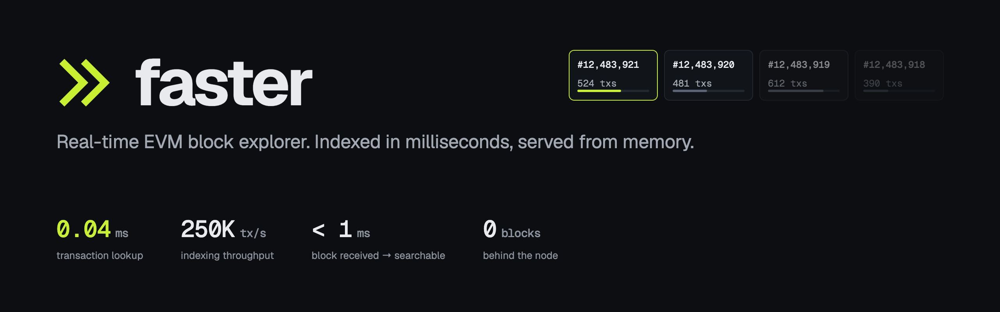
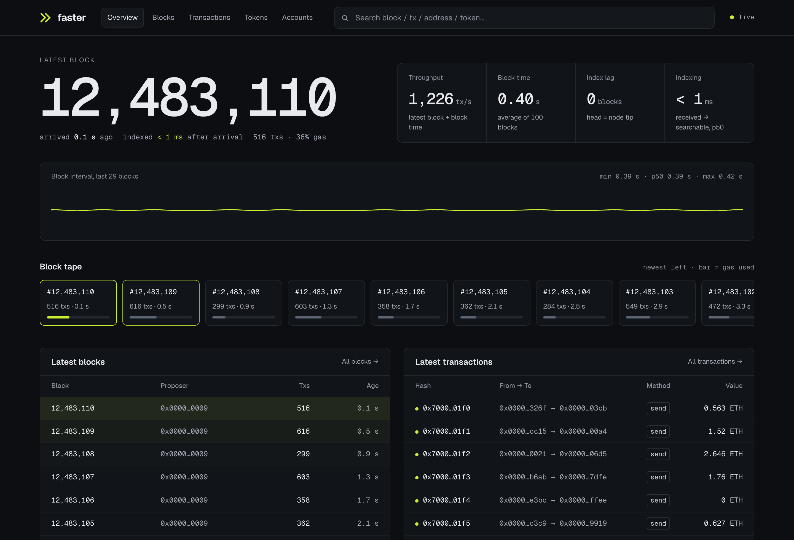
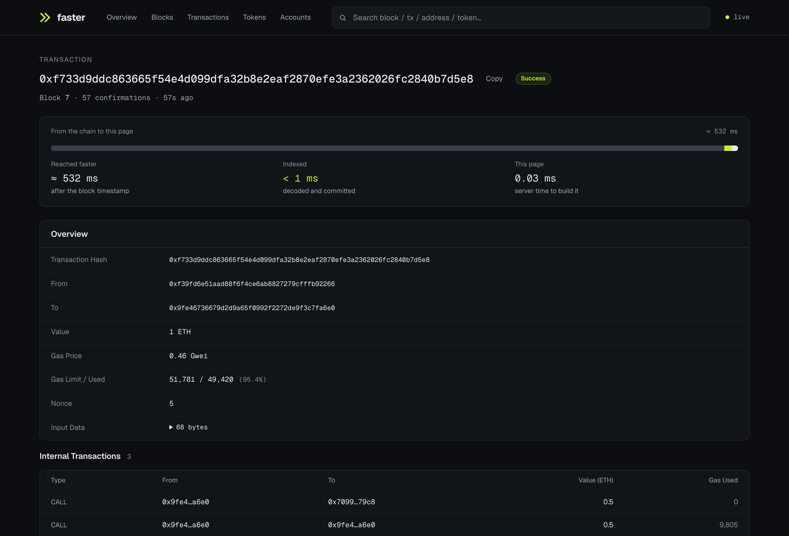
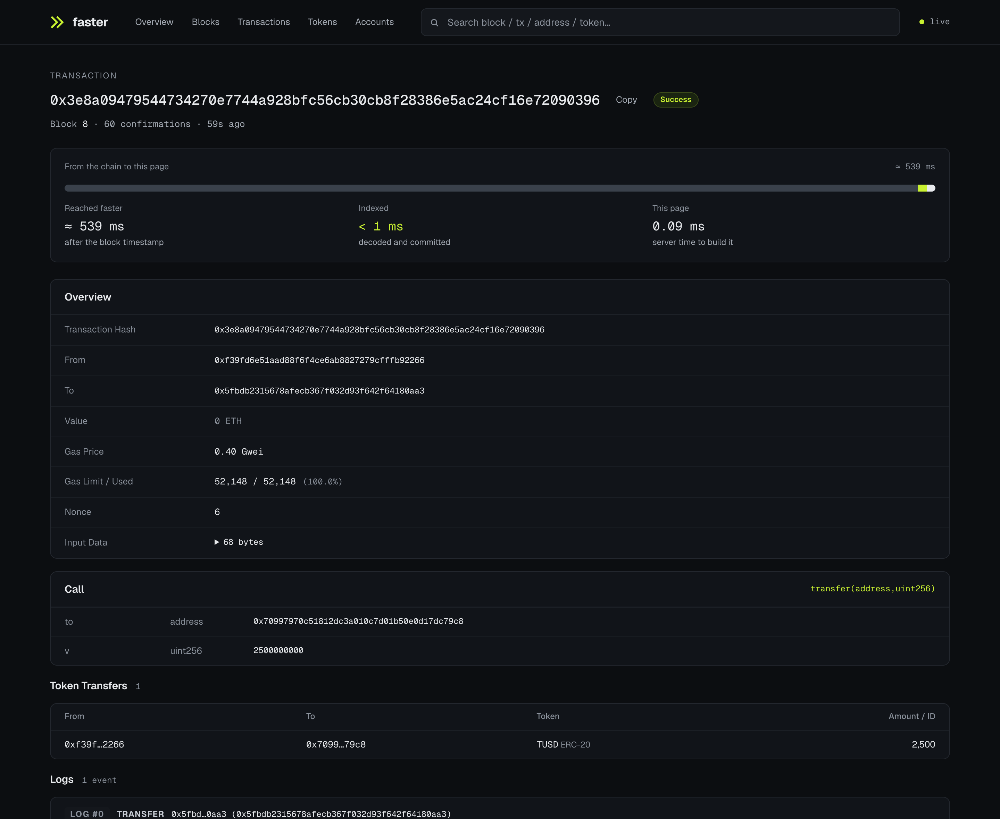
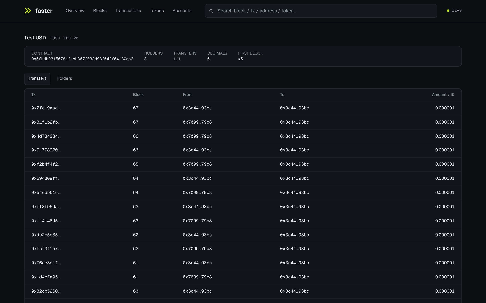
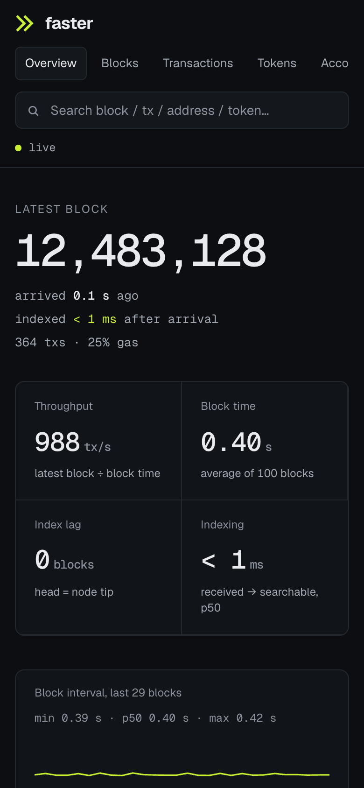

<p align="center"></p>

# Faster — real-time EVM block explorer

Faster indexes any EVM chain over JSON-RPC and serves a live explorer UI. The
explorer path is one Rust process (`services/faster`) with an embedded RocksDB
store: the indexer, the REST API and the WebSocket feed read and write the same
in-process store, so a page is answered without a network hop to a database.

<p align="center"></p>

| | |
|---|---|
| Ingest | ~250K tx/s sustained into the store (synthetic node, 8-core laptop); on a real node the node's RPC is usually the limit |
| Lookups | tx by hash 0.04 ms server time; address page (25 txs) 0.25 ms; ~90K req/s per instance |
| Live | blocks, txs and stats pushed over WebSocket as each block is committed |
| Correctness | atomic per-commit writes, crash-safe restart, reorg rollback (parent-hash + head checks, undo journal) |

Measurements and method: [docs/STORE.md](docs/STORE.md). Why this storage
design: [docs/STORAGE_BENCHMARK.md](docs/STORAGE_BENCHMARK.md) (13 engines
compared).

## Screenshots

| | |
|---|---|
|  |  |
| Transaction: where the time went, from the block to this page, plus internal calls | Verified contract: decoded call, token transfer and decoded event |
|  |  |
| Token: holders and transfers, metadata read from the contract | Phone layout |

The home screenshot is a synthetic chain (`fakenode … live`, 0.4 s blocks, ~450
txs per block); the others are a local anvil chain with real ERC-20/721
contracts. The banner's numbers are measurements from
[docs/STORE.md](docs/STORE.md) (laptop, synthetic node).

## Services

| Service | What it does |
|---|---|
| `services/faster` (Rust) | Chain indexer + RocksDB hot store + explorer API (`/api/*`, `/stats`, WebSocket `/ws`) + CLOB history API (`/api/clob/*`, reads ClickHouse). Metrics and backups on an internal admin port. |
| `services/frontend` (React + TypeScript) | Explorer UI, served by nginx, which is also the public entry point and proxies the API. |
| `services/clobarchiver` (Go) | Optional: loads an evm-node's CLOB order/fill archive into ClickHouse ([docs/CLOB_ARCHIVE.md](docs/CLOB_ARCHIVE.md)). |
| ClickHouse | Optional: CLOB history (analytics tier). |

## Quick start

Requirements: Docker with Compose v2 and an EVM JSON-RPC endpoint
(`eth_getBlockReceipts` is used when the node has it).

```bash
cp .env.example .env        # set RPC_URL
docker compose up -d --build
open http://localhost:4000  # UI; the API is on the same origin (/api, /stats, /ws)
```

Indexing starts at `START_BLOCK` (default 0) and follows the chain head.
`GET /ready` turns 200 once the store is within `READY_MAX_LAG` blocks of the
node.

Without the CLOB archive, remove `clickhouse` and `clobarchiver` from the
compose file; `/api/clob/*` then answers 503 and the UI hides nothing else.

## Development

```bash
# backend
cd services/faster
cargo test                                   # unit + fake-node reorg/crash e2e tests
RPC_URL=http://localhost:8545 cargo run --release

# synthetic chain for benchmarks: 2,000 blocks x 500 txs
cargo run --release --bin fakenode -- 18546 2000 500

# frontend (dev server proxies nothing; point it at a running faster)
cd services/frontend && npm ci
VITE_API_URL=http://localhost:3000 npm run dev
```

ClickHouse integration test: `CLOB_CH_TEST=1 CLICKHOUSE_URL=http://127.0.0.1:8123 cargo test`.

## Documentation

- [docs/DEPLOYMENT.md](docs/DEPLOYMENT.md) — configuration, operations, backups, monitoring, scaling
- [docs/API.md](docs/API.md) — REST and WebSocket reference
- [docs/STORE.md](docs/STORE.md) — store layout, write path, reorg handling, measurements
- [docs/CLOB_ARCHIVE.md](docs/CLOB_ARCHIVE.md) — CLOB archive pipeline
- [CHANGELOG.md](CHANGELOG.md)
